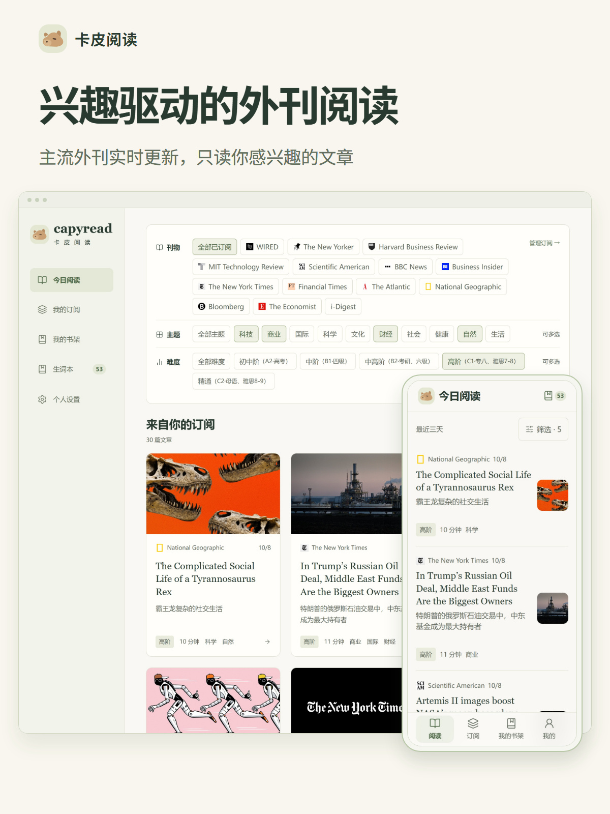
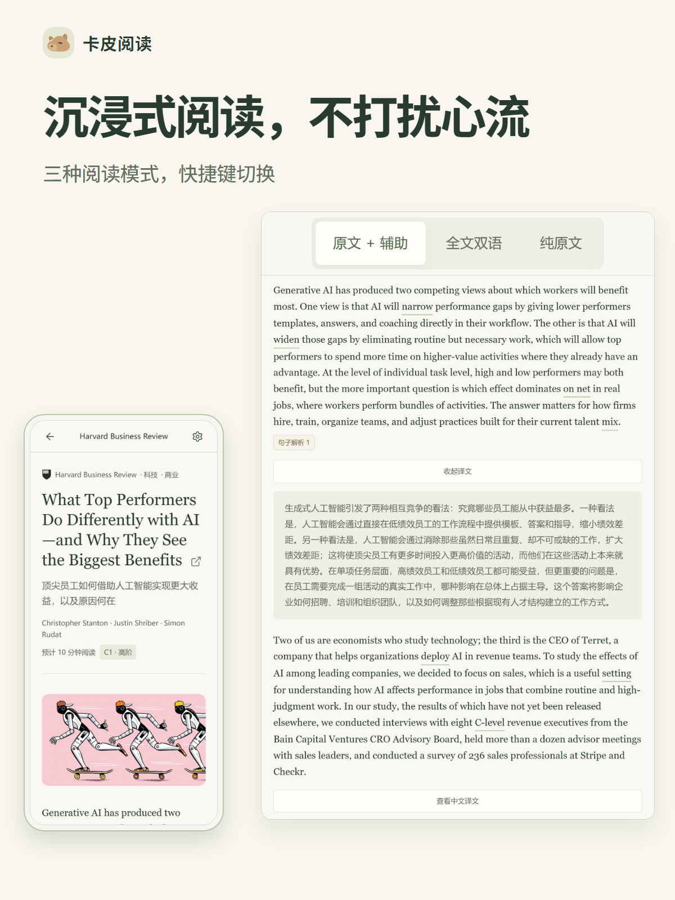
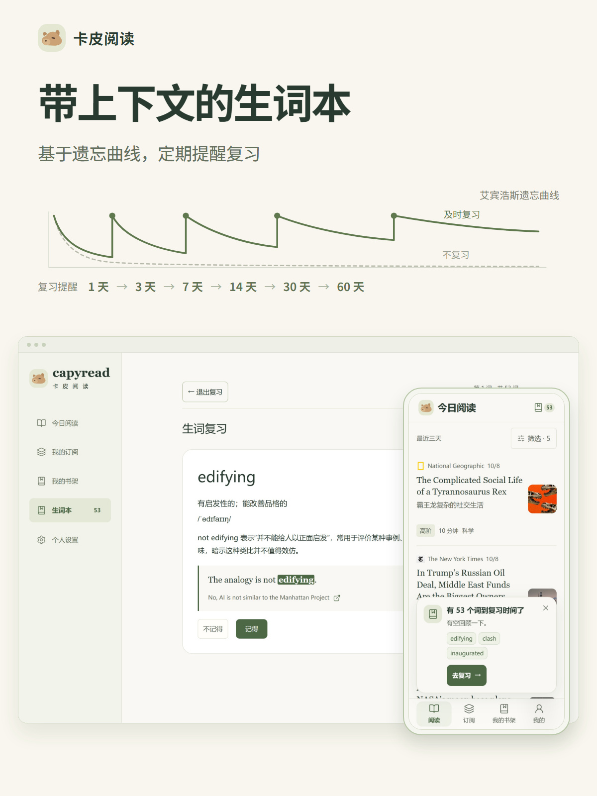
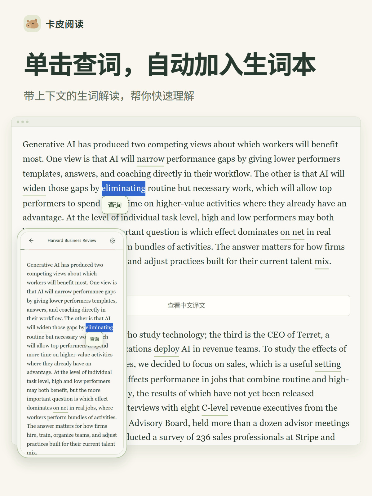
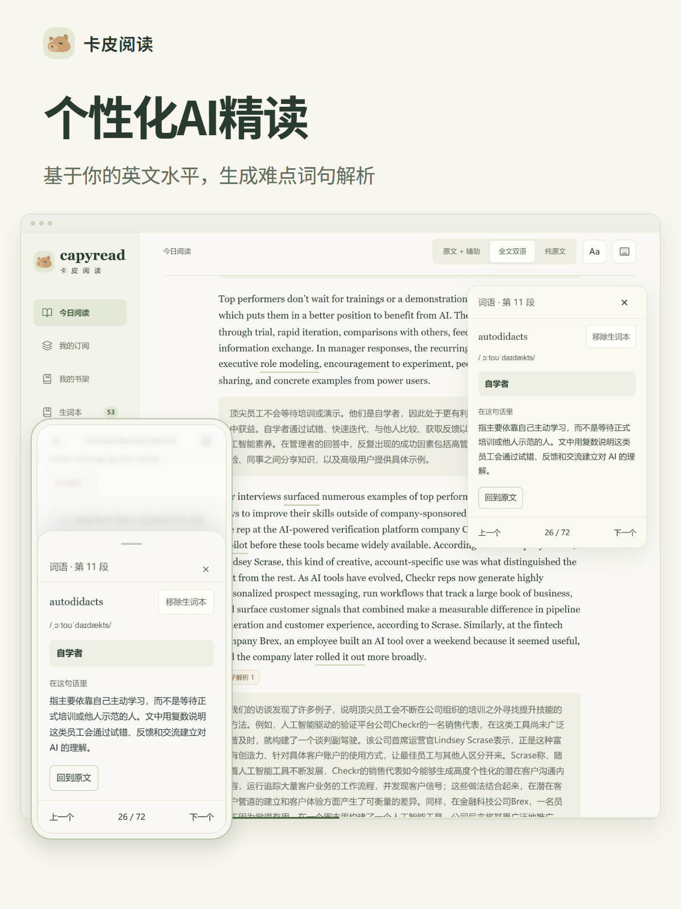
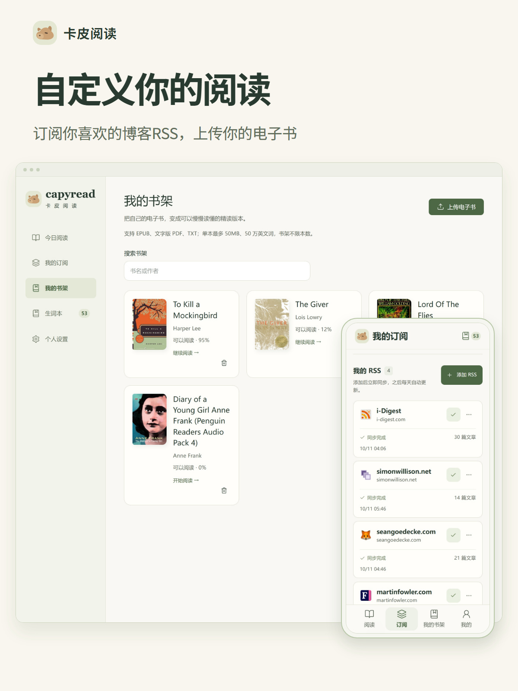

# CapyRead · 卡皮阅读

**Read what interests you. Build your English through real articles and books.**

[Visit CapyRead / 访问官网](https://capyread.com)

CapyRead is an English reading app for Chinese-speaking learners. Read articles, RSS feeds and ebooks with English–Chinese parallel text, contextual word lookup, personalized AI explanations and spaced vocabulary review.

## Why CapyRead

The idea started with a simple wish: read interesting international publications in one place, build a habit of reading English, and keep up with ideas from around the world.

Instead of choosing reading material only for language practice, start with a story, topic or book you already want to understand.

## What you can do

- **Discover articles:** follow fresh reading from major publications.
- **Read with bilingual support:** switch translation visibility as you read, including with keyboard shortcuts.
- **Look up words in context:** click unfamiliar words to understand them within the passage.
- **Get personalized AI explanations:** explore difficult vocabulary and sentences based on your English level.
- **Keep vocabulary connected to reading:** save words with their original sentences and revisit them through spaced review.
- **Bring your own reading:** subscribe to blogs through RSS, upload ebooks, or start with a curated original-language book.

## 卡皮阅读：兴趣驱动的 AI 外刊精读

做这个产品的初心，是想要一站式阅读自己感兴趣的外刊。在积累英文阅读量的同时，了解这个世界正在发生的前沿信息。

从感兴趣的外刊开始，用中英对照、随手查词与个性化 AI 精读读懂真实文章。带原句的生词本和间隔复习，让阅读留下积累；支持订阅博客 RSS、上传电子书，还有精选豆瓣高分原版书，一键开启阅读。

## Product tour / 功能展示

### Interest-led reading / 从兴趣开始

### Immersive reading / 沉浸式阅读

### Vocabulary review / 带语境的生词复习

### Contextual lookup / 单击查词

### Personalized AI / 个性化 AI 精读

### RSS and ebooks / 自定义阅读

## Get started

Explore the product and current membership options at **[capyread.com](https://capyread.com)**.

This repository contains the product introduction and screenshots. CapyRead runs at the website linked above.
